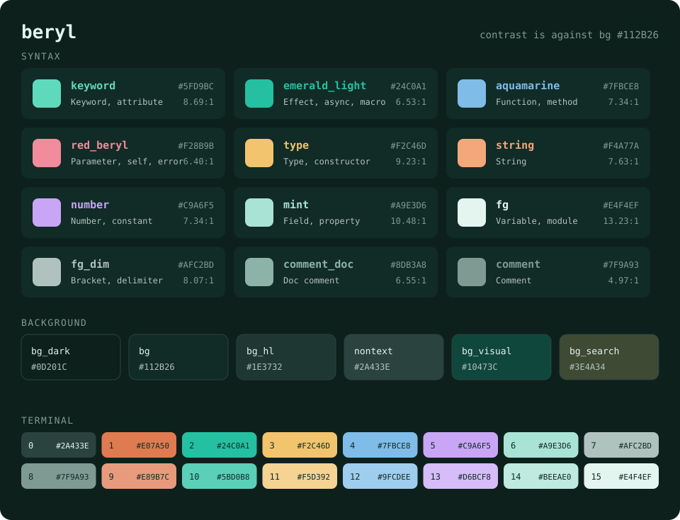

# beryl.vim

A dark Neovim colorscheme in deep emerald, written in Lua.

The palette comes from the logo and slides of [Emela](https://github.com/emela-lang/emela),
a programming language. Emerald is a variety of beryl, hence the name.


## Features

- Standard highlight groups, Treesitter captures and LSP semantic tokens
- Themes for Ghostty, Claude Code, OpenCode, bat, delta, VS Code and Zed,
  generated from the same palette
- Diagnostics in four distinct hues: error, warning, info and hint
- Plugin support: [gitsigns.nvim](https://github.com/lewis6991/gitsigns.nvim),
  [telescope.nvim](https://github.com/nvim-telescope/telescope.nvim) and a
  [lualine.nvim](https://github.com/nvim-lualine/lualine.nvim) theme
- The 16 terminal colors (`terminal_color_0` to `terminal_color_15`)
- Optional transparent background
- All body text meets WCAG AA (4.5:1) against the background

## Requirements

- Neovim 0.10 or later
- `termguicolors` (beryl turns it on when loaded)

## Installation

With [lazy.nvim](https://github.com/folke/lazy.nvim):

```lua
{
  "Allianaab2m/beryl.vim",
  lazy = false,
  priority = 1000,
  config = function()
    require("beryl").setup({})
    vim.cmd.colorscheme("beryl")
  end,
}
```

Or just run `:colorscheme beryl` after installing it with any plugin manager.

## Configuration

These are the defaults. Call `setup` before `:colorscheme beryl`.

```lua
require("beryl").setup({
  -- Leave the background unset so the terminal background shows through
  transparent = false,
  italic_comments = true,
  -- Set terminal_color_0 to terminal_color_15
  terminal_colors = true,
  -- Override or add highlight groups
  on_highlights = function(highlights, palette)
    -- highlights.CursorLine = { bg = palette.bg_dark }
  end,
})
```

### lualine

```lua
require("lualine").setup({
  options = { theme = "beryl" },
})
```

## Other apps

Themes for other apps live in [`extras/`](extras):

- [Ghostty](https://ghostty.org): copy `extras/ghostty/beryl` to
  `~/.config/ghostty/themes/beryl`, then set `theme = beryl` in your config
- [Claude Code](https://claude.com/claude-code): copy `extras/claude-code/beryl.json`
  to `~/.claude/themes/beryl.json`, then pick Beryl in `/theme`
- [OpenCode](https://opencode.ai): copy `extras/opencode/beryl.json` to
  `~/.config/opencode/themes/beryl.json`, then pick beryl in the theme settings
  (`Ctrl+P`, Open settings, Theme) or set it in `~/.config/opencode/cli.json`:
  `{ "theme": { "name": "beryl" } }`. beryl is dark only
- [VS Code](https://code.visualstudio.com): `extras/vscode` is the extension
  folder. Link or copy it to `~/.vscode/extensions/beryl`, reload, then pick
  Beryl in Preferences: Color Theme
- [Zed](https://zed.dev): copy `extras/zed/themes/beryl.json` to
  `~/.config/zed/themes/`, or install `extras/zed` with
  zed: install dev extension, then pick Beryl in theme selector: toggle.
  Zed cannot override colors per language, so Emela parameters are red beryl
  there
- [bat](https://github.com/sharkdp/bat): copy `extras/bat/beryl.tmTheme` to
  `$(bat --config-dir)/themes/`, run `bat cache --build`, then set
  `--theme=beryl`
- [delta](https://github.com/dandavison/delta): install the bat theme above, add
  `extras/delta/beryl.gitconfig` to your git config with `[include] path = ...`,
  then set `features = beryl` under `[delta]`

## Palette



The colors beyond the original Emela palette come from other varieties of
beryl: aquamarine for functions and red beryl for parameters and errors.

| Role | Color | Contrast |
| --- | --- | --- |
| Foreground: variable, module | `#E4F4EF` | 13.23:1 |
| Field, property | `#A9E3D6` | 10.48:1 |
| Type, constructor | `#F2C46D` | 9.23:1 |
| Keyword, attribute | `#5FD9BC` | 8.69:1 |
| Bracket, delimiter | `#AFC2BD` | 8.07:1 |
| String | `#F4A77A` | 7.63:1 |
| Function, method | `#7FBCE8` | 7.34:1 |
| Number, constant | `#C9A6F5` | 7.34:1 |
| Doc comment | `#8DB3A8` | 6.55:1 |
| Effect, `async`/`await`, macro | `#24C0A1` | 6.53:1 |
| Parameter, `self`/`this`, error type, `throw`/`fail` | `#F28B9B` | 6.40:1 |
| Error | `#E07A50` | 5.06:1 |
| Comment (italic) | `#7F9A93` | 4.97:1 |

Contrast is against the background `#112B26`.

Two colors carry meaning across languages: the logo green marks where side
effects enter (Emela effects, `async`/`await`), and red beryl marks where a
function can fail (Emela error types and `fail`, `throw`/`try`/`catch`). In
Emela, parameters stay in the foreground color so they do not clash with error
types in a signature. Effect names and error types are colored through the
`@type.effect` and `@type.error` captures; editors that do not know them fall
back to `@type`.

The full palette, including the derived background shades, is in
[`lua/beryl/palette.lua`](lua/beryl/palette.lua). `assets/palette.svg` is
generated from it.

## Layout

```
colors/beryl.lua              entry point for :colorscheme
lua/beryl/palette.lua         every color value lives here
lua/beryl/groups/             highlight definitions, one file per area
lua/beryl/terminal.lua        terminal colors
scripts/build.lua             generates extras/ and assets/palette.svg from the palette
extras/                       themes for other apps (generated, do not edit)
lua/beryl/lualine.lua         lualine theme
lua/lualine/themes/beryl.lua  lets lualine find the theme by name
```

## Development

`lua/beryl/palette.lua` is the single source for every color. After changing
it, regenerate the themes in `extras/` and the palette image:

```sh
nvim -l scripts/build.lua
```

## License

[MIT](LICENSE)
